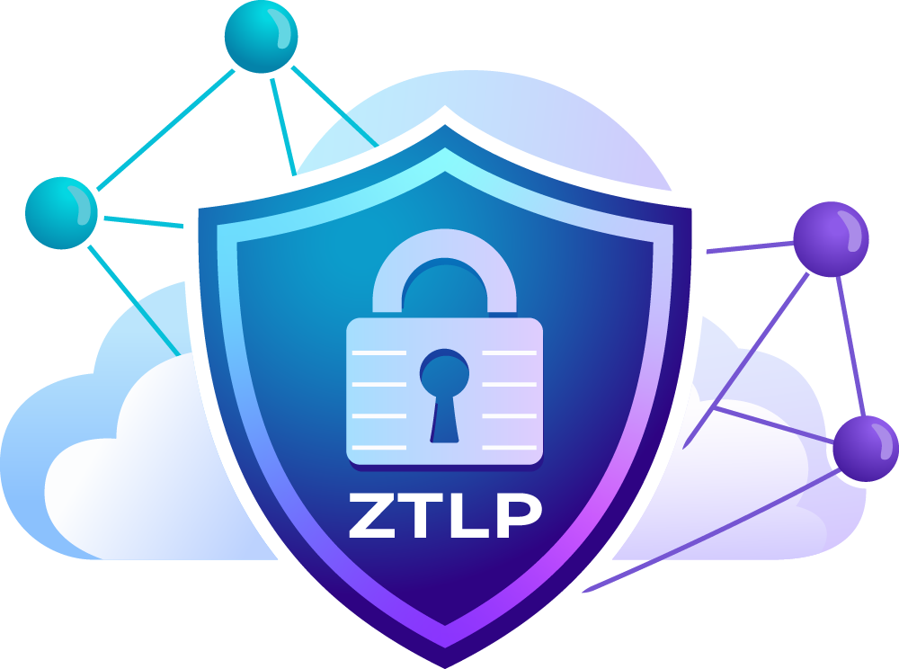
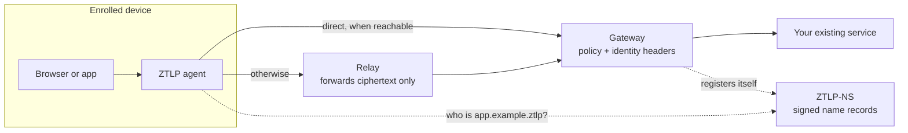

<p align="center">
  
</p>

<h1 align="center">ZTLP: Zero Trust Layer Protocol</h1>

<p align="center">
  An identity-first network overlay. Nothing is reachable until it has proven who it is.
</p>

<p align="center">
  <a href="https://github.com/priceflex/ztlp/actions/workflows/ci.yml"></a>
  <a href="LICENSE"></a>
  <a href="https://github.com/priceflex/ztlp/releases"></a>
  <a href="proto/"></a>
  <a href="relay/"></a>
</p>

<p align="center">
  <a href="https://ztlp.org">ztlp.org</a> ·
  <a href="docs/getting-started/quick-start.md">Quick start</a> ·
  <a href="docs/README.md">Documentation</a> ·
  <a href="docs/reference/specification.md">Specification</a> ·
  <a href="whitepaper/ZTLP-Whitepaper.md">Whitepaper</a>
</p>

---

## What ZTLP is

The Internet carries any packet from any source and leaves security to each
endpoint. ZTLP turns that around. It is an overlay protocol that runs on top of
ordinary IPv4 and IPv6 and requires a cryptographic identity before any
connection state exists. A service behind ZTLP has no open port to scan, no
login page to attack, and nothing to answer a packet that does not belong to
an authenticated session.

| Problem today | With ZTLP |
|---|---|
| Any address can probe any port | Services have no public ports and cannot be discovered |
| Servers must process every packet of a flood | Invalid packets are dropped before any state is allocated |
| Anyone can reach your login page | No connection without a device identity |
| An attacker inside the network moves freely | Every connection is mutually authenticated and checked against policy |

You do not replace your network to use it. A gateway sits in front of the
services you already run, and enrolled devices reach them by name.

## How it works



- **Identity, not location.** Every device has a NodeID bound to a key pair.
  Names such as `app.example.ztlp` resolve through ZTLP-NS, a namespace of
  signed records, to the identity of a gateway and the ways to reach it.
- **Admission before state.** Each packet passes a three-step check, cheapest
  first: a magic byte, a SessionID allow-list lookup, then authenticated
  header verification. Most junk traffic is discarded in the first two steps
  with no cryptography and no memory allocated.
- **Mutual authentication.** Sessions are set up with a Noise_XX handshake.
  Both ends prove their identity; the gateway then applies policy by device,
  user and group.
- **Relays cannot read traffic.** When a direct path is not available, a relay
  forwards encrypted packets by SessionID. It holds no keys for the session.
- **Applications need no changes.** The gateway forwards to an ordinary TCP
  backend and can add signed identity headers, so a web app can sign users in
  without a password.

The [architecture overview](docs/architecture/overview.md) and the
[diagrams](docs/architecture/diagrams/README.md) go deeper; the
[specification](docs/reference/specification.md) is the full protocol.

## Components

| Directory | What it is | Built with |
|---|---|---|
| [`proto/`](proto/) | Protocol library, the `ztlp` command line tool and the device agent | Rust |
| [`relay/`](relay/) | Relay mesh that forwards sessions between networks | Elixir/OTP |
| [`ns/`](ns/) | ZTLP-NS, the signed distributed namespace | Elixir/OTP |
| [`gateway/`](gateway/) | Bridge from ZTLP sessions to existing TCP services | Elixir/OTP |
| [`admin/`](admin/) | Admin panel for zones, devices, users and services | Ruby on Rails |
| [`bootstrap/`](bootstrap/) | Fleet provisioning and enrollment service | Ruby on Rails |
| [`ebpf/`](ebpf/) | Optional XDP packet filter for the first admission steps | C |
| [`sdk/go/`](sdk/go/) | Client SDK | Go |

Clients:

| Platform | Where | Status |
|---|---|---|
| macOS | [`macos/`](macos/) | Released |
| Windows and Linux | [`desktop/`](desktop/) | Released |
| Any platform with a shell | `ztlp` from [`proto/`](proto/) | Released |
| iPhone | [`ios/`](ios/) | In development |

On every platform the goal is the same: enroll once, then open
`https://app.example.ztlp` in a browser with no port number and no VPN switch
to flip.

## Get started

**Try it locally.** The [quick start](docs/getting-started/quick-start.md)
explains the concepts and walks through an authenticated connection between
two nodes. [Docker](docs/getting-started/docker.md) covers the compose files
at the root of this repository.

**Run your own zone.** One script sets up a name server, a relay and the admin
panel on a Linux server. The panel is reachable only through ZTLP.

```bash
# 1. Build the server images (x86_64 Linux with Docker)
git clone https://github.com/priceflex/ztlp && cd ztlp
scripts/build-server-images.sh

# 2. Install on a server with a public address (open UDP 23095 and 23096)
scp ztlp-server-images-*.tar scripts/ztlp-bootstrap ubuntu@<server>:~
ssh ubuntu@<server> ./ztlp-bootstrap --load-from 'ztlp-server-images-*.tar'

# 3. Enroll your computer with the token it prints
ztlp setup --token 'ztlp://enroll/...' --name <your computer> --yes
```

Then start the agent and open `http://admin.<your zone>`. You are signed in as
its administrator, with no password. The full walkthrough, including the
firewall, backups and adding devices, is in
[Run your own zone](docs/getting-started/run-your-own-zone.md).

## Documentation

| Section | Start here |
|---|---|
| Getting started | [Quick start](docs/getting-started/quick-start.md), [use cases](docs/getting-started/use-cases.md), [run your own zone](docs/getting-started/run-your-own-zone.md) |
| Architecture | [Overview](docs/architecture/overview.md), [identity](docs/architecture/identity.md), [threat model](docs/architecture/threat-model.md), [NAT traversal](docs/architecture/nat-traversal.md) |
| Operations | [Deployment](docs/operations/deployment.md), [runbook](docs/operations/runbook.md), [key management](docs/operations/key-management.md), [firewall](docs/operations/firewall.md) |
| Reference | [Specification](docs/reference/specification.md), [CLI](docs/reference/cli.md), [identity headers](docs/reference/identity-headers.md), [Go SDK](docs/reference/go-sdk.md) |
| Admin panel | [Specification](docs/admin-panel/specification.md) |
| Security | [Security policy](SECURITY.md), [audits](docs/security/) |

The complete index is in [docs/README.md](docs/README.md). Release history is
in the [changelog](CHANGELOG.md).

## Project status

ZTLP is experimental. The protocol specification is a working document, not an
IETF RFC, and the wire format can still change before 1.0. The implementation
in this repository is in daily use, and each release is listed in the
[changelog](CHANGELOG.md).

## Contributing

Contributions are welcome. Read [CONTRIBUTING.md](CONTRIBUTING.md) for how to
build and test each component, and the
[good first issues](docs/development/good-first-issues.md) for places to
start. Everyone taking part is expected to follow the
[code of conduct](CODE_OF_CONDUCT.md).

To report a vulnerability, follow the [security policy](SECURITY.md). Please
do not open a public issue for it.

## License

Apache License 2.0. See [LICENSE](LICENSE) and [NOTICE](NOTICE).

ZTLP is a trademark of Tech Rockstar Academy. Use of the name and brand is
subject to its trademark guidelines.

ZTLP was created by Steven Price and is developed as part of the Tech Rockstar
Academy research initiative.
